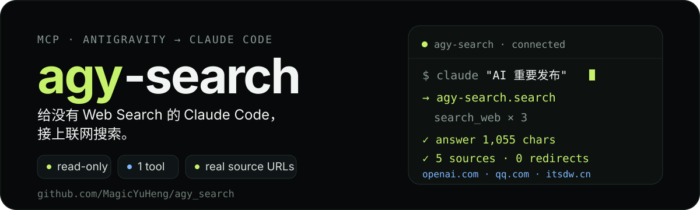
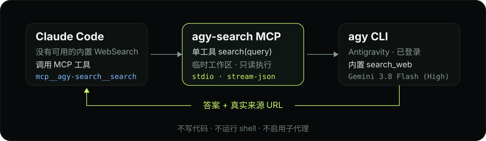

<p align="center">
  
</p>

<p align="center">
  <a href="https://modelcontextprotocol.io"></a>
  
  
  
</p>

> **一种基于「反重力」（Antigravity）向没有 Web Search 能力的 Claude Code 提供搜索的服务。**
>
> A tiny MCP server that gives Claude Code web search through the Antigravity CLI you already have installed and logged in.

Claude Code 的内置 WebSearch 在部分环境里不可用：未启用、被代理限制，或账号与地区不支持。`agy-search` 把本机 `agy` 的 `search_web` 包成一个只读 MCP 工具：传入一个 query，返回简明答案和真实来源链接。

## 它是什么

- **一个工具**：`search(query)`。schema 只有一个参数，几乎不占上下文。
- **只读**：每次调用在一次性临时目录中执行，不使用 `--dangerously-skip-permissions`；不写代码、不跑 shell、不启用子代理。
- **来源真实**：服务端把 Google grounding 返回的长跳转链接并行解析成发布者 URL，答案最多保留 5 条来源。
- **模型可配**：默认 `gemini-3.8-flash-high`，可用 `AGY_SEARCH_MODEL` 改成任意 `agy models` 中的模型。
- **失败可恢复**：agy 卡死或返回空答案时自动换新进程重试一次。

## 真实输出

以下是 2026-10-24 在 `gemini-3.8-flash-high` 上通过 MCP 链路得到的真实结果（节选）：

```text
> What is the latest stable Python version and its release date?

The latest stable Python version is **Python 3.15.1**, released on **October 21, 2026**.

Sources:
- https://docs.python.org/3/whatsnew/3.15.html
- https://www.python.org/downloads/latest/
- https://www.python.org/downloads/
```

答案约 300 字符，来源均为 `python.org` 的真实页面；没有保留任何 grounding 跳转链接。

## 工作方式

<p align="center">
  
</p>

Claude Code 调用 `mcp__agy-search__search` → `agy-search` 在临时目录中启动 `agy -p` → agy 使用内置 `search_web` → 服务端解析事件流、清理来源链接，把答案返回给 Claude Code。

## 快速开始

**前置条件**

1. 已安装并登录 [Antigravity CLI](https://antigravity.google)：

   ```bash
   agy --version
   agy -p "say hi"
   ```

   `agy -p` 会读取 stdin；如果命令挂住，用 `agy -p "say hi" < /dev/null`（Windows 可省略）。

2. Python 3.10+，以及可用的 `claude` CLI。

**macOS / Linux**

```bash
git clone https://github.com/MagicYuHeng/agy_search.git
cd agy_search
python3 -m venv .venv
.venv/bin/pip install -e .
claude mcp add --scope user agy-search -e AGY_SEARCH_MODEL=gemini-3.8-flash-high -- "$PWD/.venv/bin/python" -m agy_search.server
```

**Windows（PowerShell）**

```powershell
git clone https://github.com/MagicYuHeng/agy_search.git
cd agy_search
python -m venv .venv
.\.venv\Scripts\pip.exe install -e .
claude mcp add --scope user agy-search -e AGY_SEARCH_MODEL=gemini-3.8-flash-high -- "$PWD\.venv\Scripts\python.exe" -m agy_search.server
```

注册后**新开一个 Claude Code 会话**，工具会以 `mcp__agy-search__search` 出现。可以先验证：

```bash
.venv/bin/python tests/mcp_smoke.py "今天 UTC 日期"
```

Windows 把 `.venv/bin/python` 换成 `.venv\Scripts\python.exe`。

## 交给 agent 一键安装

把下面整段复制给 Claude Code / Codex / 其他能执行命令的 agent：

```text
请帮我在本机安装并注册开源项目 agy-search（仓库：https://github.com/MagicYuHeng/agy_search）。

目标：让 Claude Code 获得联网搜索工具 mcp__agy-search__search。

请按顺序执行：
1. 检查前置条件：`agy --version` 可用，且 `agy -p "say hi"` 能返回内容；Python >= 3.10；`claude` CLI 可用。任一不满足就停止并说明原因。
2. 克隆仓库到 ~/tools/agy_search（Windows 为 %USERPROFILE%\tools\agy_search）；目录已存在则执行 git pull。
3. 在仓库内创建 .venv，并执行 `pip install -e .`。
4. 注册用户级 MCP（按操作系统选择）：
   - Windows：claude mcp add --scope user agy-search -e AGY_SEARCH_MODEL=gemini-3.8-flash-high -- "<仓库路径>\.venv\Scripts\python.exe" -m agy_search.server
   - macOS/Linux：claude mcp add --scope user agy-search -e AGY_SEARCH_MODEL=gemini-3.8-flash-high -- "<仓库路径>/.venv/bin/python" -m agy_search.server
5. 运行 `claude mcp list`，确认 agy-search 的状态为 Connected。
6. 运行 MCP 冒烟测试：`"<仓库路径>/.venv/bin/python" tests/mcp_smoke.py "今天 UTC 日期"`（Windows 用 .venv\Scripts\python.exe），确认返回非空答案。
7. 报告实际执行的命令、MCP 状态和测试结果。

安全约束：不要使用 --dangerously-skip-permissions；不要修改与安装无关的配置；只写入仓库目录和 Claude Code 的 MCP 配置。
```

## 配置

| 变量 | 默认值 | 说明 |
|---|---|---|
| `AGY_SEARCH_MODEL` | `gemini-3.8-flash-high` | 默认模型 id（`agy models` 第一列） |
| `AGY_SEARCH_EFFORT` | 空 | 可选的 `--effort`（low/medium/high/xhigh/max） |
| `AGY_SEARCH_TIMEOUT` | `120` | 单次调用硬超时（秒） |
| `AGY_SEARCH_RETRIES` | `1` | 硬超时后的重试次数 |
| `AGY_SEARCH_MAX_CHARS` | `8000` | 返回文本上限，超出截断 |
| `AGY_SEARCH_RESOLVE_SOURCES` | `1` | 是否把 grounding 跳转链接解析成真实 URL |
| `AGY_SEARCH_RESOLVE_TIMEOUT` | `4` | 单条链接解析超时（秒） |
| `AGY_BIN` | `agy` | agy 可执行文件路径 |

修改默认模型时，重新执行一次 `claude mcp add`（覆盖同名配置），或直接编辑 `~/.claude.json` 中 `agy-search` 的 `env`。

## 限制

- 搜索质量与可用性取决于 Antigravity 的 Google 搜索和你的账号额度；使用前必须在本机登录 `agy`。
- 这是**搜索工具**，不是通用代理：不能生成图片、写代码或执行命令。
- 对需要登录、强反爬的内容（例如部分 X/Twitter 页面）可能拿不到完整信息。
- 目前从源码安装，尚未发布到 PyPI。
- 本项目与 Google / Antigravity 无隶属关系。

## 致谢

`agy-search` 的调用契约和封装思路来自下面两个优秀的 MIT 项目，感谢作者的工作：

- **[tphakala/agy-mcp](https://github.com/tphakala/agy-mcp)** — 采用 `--output-format stream-json` 驱动 agy、解析 `init` / `step_update` / `result` 事件流、显式关闭 stdin、用 `--print-timeout` 留出安全预算，以及对失败状态的分类处理。
- **[andyleimc-source/agy-mcp](https://github.com/andyleimc-source/agy-mcp)** — 极简的 Python MCP 封装、在一次性目录中运行 `agy -p`、超时重试，以及「校验实际结果而不是只信模型口述」的思路。

本仓库的搜索提示词、来源链接解析、只读约束与测试为本项目自有实现。完整的版权与 MIT 许可文本见 [NOTICE](./NOTICE)。

## License

[MIT](./LICENSE) © 2026 MagicYuHeng
